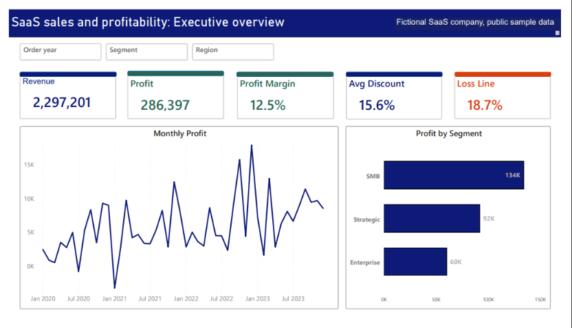
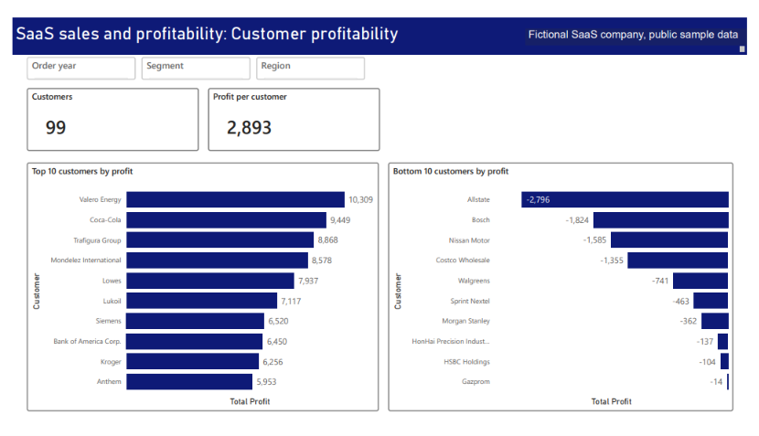
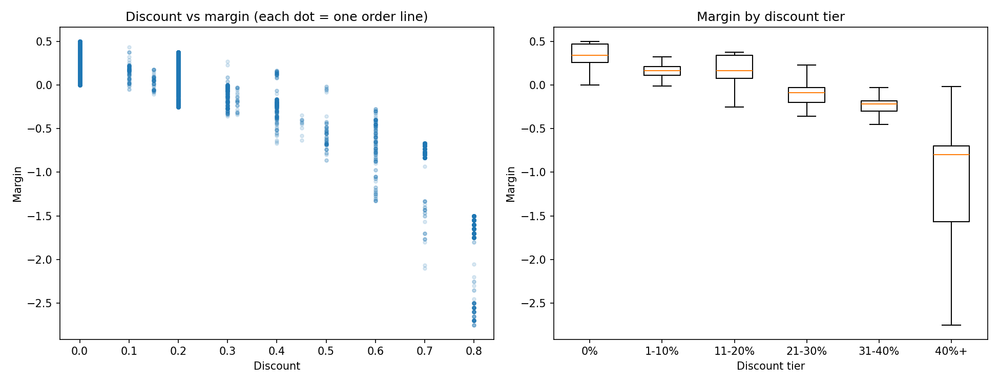
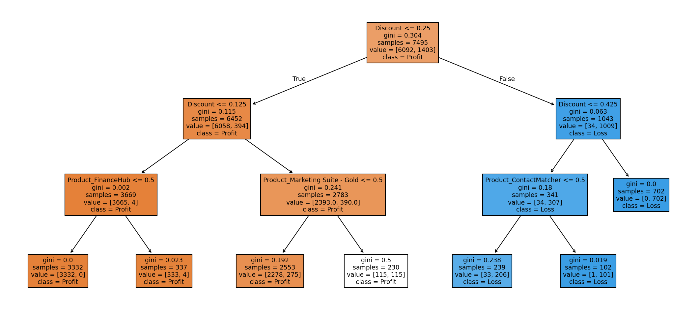

# SaaS Sales, Discount and Profitability Dashboard

Which products and segments make money, and where do discounts destroy profit?

Data: "Amazon AWS SaaS Sales Dataset" on Kaggle, published by nnthanh101. Fictitious B2B SaaS company, not real AWS business data. 9,994 order lines, 2020 to 2023.
Source: https://www.kaggle.com/datasets/nnthanh101/aws-saas-sales
Licence: GNU Free Documentation License 1.3 (https://www.gnu.org/licenses/fdl-1.3.html)
The dataset is not included in this repository. Download it from the source link and save it as Data/Raw/SaaS-Sales.csv to rerun the notebooks.

Tools: Excel (Power Query, pivots), SQL, Python (pandas, scipy, scikit-learn), Power BI (DAX)

## Key findings
- Revenue 2,297,201 and profit 286,397, a 12.5% margin. 18.7% of order lines lose money.
- Lines discounted above 20% lost 135,376 in total. 91.6% to 100% of lines above 20% were loss-making, against 14.0% at 11-20%.
- Marketing Suite is the only loss-making product (-3,473).
- The top 10 customers earn 27% of profit. The bottom 10 all lose money (9,381 in total).
- Discount and profit are negatively correlated (Spearman rho = -0.54). This is association, not proof of cause.

## Dashboard

## Statistical analysis

## What is in this repository
- Power BI/ : dashboard PDF
- SQL/ : 10 queries (segment, product, discount tier, monthly trend, loss customers, discount-cap summary)
- Notebooks/ : 01_audit, 02_sql, 03_stats, 04_tree, 05_whatif, Stats_Results
- Excels/ : what-if discount cap scenarios
- DOCs/ : BRD, analysis report, presentation (Word, PowerPoint and PDF), data quality log, problem statement
- Images/ : dashboard and analysis pictures

## Limits
Sample data for a fictitious company. The discount-cap result is a scenario, not a forecast.

## Contact
Manju Suthar | linkedin.com/in/manju-suthar06
